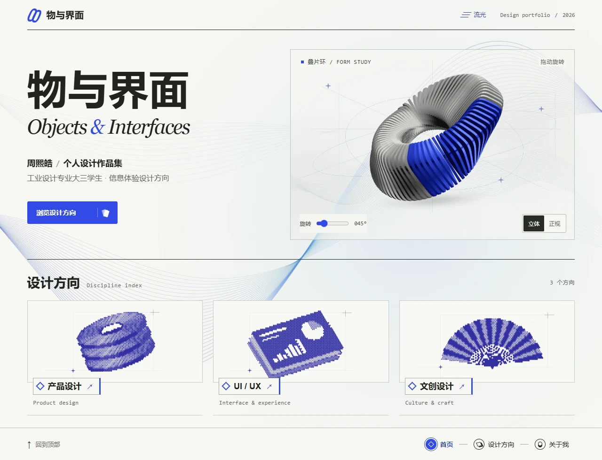

# 物与界面 · Objects & Interfaces

我是周熙皓，工业设计专业大三学生，学习方向是信息体验设计。《物与界面》是我的个人作品集，围绕产品设计、UI / UX 和文创设计展开。

**[在线浏览《物与界面》](https://wuyujiemian.pages.dev/)**

目前可体验首页、三个设计方向的索引和关于页。每个方向都可以展开案例提纲，第一篇完整的课程项目案例待补。

## 可以从这里开始

| 设计方向 | 我关注的问题 | 案例将呈现的材料 |
| --- | --- | --- |
| [产品设计](https://wuyujiemian.pages.dev/work#object) | 手拿起一个物件时，哪些尺寸和材料影响操作？ | 手部动作、草模尺寸、实物打样 |
| [UI / UX](https://wuyujiemian.pages.dev/work#interaction) | 用户怎样找到下一步，又怎样知道任务完成了？ | 任务路径、界面取舍、可点击原型 |
| [文创设计](https://wuyujiemian.pages.dev/work#culture) | 一个纹样或地方故事怎样进入日常器物？ | 文化来源、图形转译、载体打样 |

首页的叠片环可以拖动。切到「正视」，就能比较同一组薄片从斜面和正面看时轮廓怎样变化。到了目录，我用同一色蓝墨的网点画三个物件，让人从叠片的厚度、界面的层次和扇面的折痕辨认方向。右下角的三个节点可以随时切换页面。

桌面端移动鼠标，光带会弯折；移到方向卡上，折角光标和卡片边缘的定位角会提示这里可以进入。页眉的「流光」可以开关效果。开启系统「减少动态效果」时，背景会静止。

## 网站怎样走到这一版

| 日期 | 访客能体验到的变化 | 对应提交 |
| --- | --- | --- |
| 2026-11-25 | 加入蓝青流光、折角光标和动效开关。 | [94486b0](https://github.com/kk-185/personal-design/commit/94486b0cd85710688d75415608c0fa6c3f0fe937) |
| 2026-11-25 | 三个设计方向换成网点物件，主导航移到右下角，统一中文排版。 | [be34f36](https://github.com/kk-185/personal-design/commit/be34f36e001569b29426ec983aac220e16d02725) |
| 2026-11-23 | 建立三方向首页，可旋转的叠片环、入口按钮和导航有了交互反馈。 | [b5013d9](https://github.com/kk-185/personal-design/commit/b5013d99049cea2f0320d55f3d881b137987c849) |

具体的试用记录和下一步收在[项目进度](current.md)与[历史归档](current-archive.md)。

## 在本机打开

下载仓库后，用浏览器打开 `dist/index.html`，即可离线浏览。Windows 上也可以双击 `启动本地网站.cmd`，然后访问[本机预览](http://127.0.0.1:18527/)。

## 填入首个作品

复制[案例模板](案例模板.html)到 `dist/`，去掉链接中的 `dist/` 前缀。补入题名、分工、设计取舍及证据后，在 [方向页](dist/work.html) 对应章节加入链接并移除空状态。各方向可分别使用实物打样、任务原型或文化来源与转译材料。三个分类在首页和目录中的顺序一致。

## 版式参考

- 借鉴简洁网格与强标题层级，用同一套版式容纳不同媒介。[Vinicius Germano Müller · Dribbble](https://dribbble.com/shots/26084234-Minimal-Portfolio-Website-Brand-Product-Designer)
- 参考独立作品目录的访问路径，读者从首页直达分类。[Melon Studio · Work](https://melon.studio/work)
- 参考该学生作品集公开简介所述的「概念草图到原型」，在产品方向预留草模与验证。Behance 本次仅能读取公开摘要。[Apurva Mokal · Behance](https://www.behance.net/gallery/194302995/Industrial-Design-Portfolio-2024)

